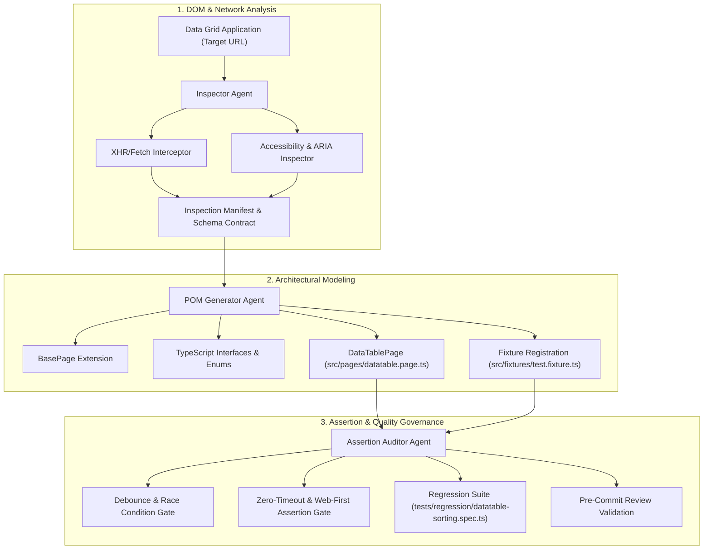

# Multi-Agent Orchestration Pattern: Dynamic Data Grid Automation

## 1. Executive Summary & Architecture

Modern data grids with server-side pagination, multi-column sorting, and asynchronous debounced filtering introduce complex timing and state synchronization challenges. Standard single-agent authoring often generates brittle locators, non-waiting assertions, or race conditions.

To resolve this, the **Table Automation Pipeline** decomposes data grid test engineering across three specialized autonomous sub-agents:



---

## 2. Agent Roles, Protocols & Operational Boundaries

### Agent 1: Inspector Agent
* **Primary Objective**: Discover the DOM topology, accessibility attributes, keyboard modifiers, and client-server network protocol of the target data grid.
* **Tools Permitted**: Playwright MCP, Network Traffic Interceptor, Accessibility Snapshot (`accessibilitySnapshot`), DOM Query Inspector.
* **Key Tasks**:
  1. Inspect the table DOM tree (`table`, `thead`, `tbody`, `tr`, `th`, `td`).
  2. Map header titles to column indices and identify sorting indicators (`aria-sort="ascending|descending"`, sorting classes `dt-ordering-asc`, `dt-ordering-desc`).
  3. Identify modifier key behaviors (e.g., `Shift + Click` for secondary multi-column sorting).
  4. Intercept server-side network requests (`server_processing.php` or REST endpoint), extracting:
     - Query Parameters: `start`, `length`, `search[value]`, `order[0][column]`, `order[0][dir]`, `order[1][column]`, `draw`.
     - Response Payload: `draw`, `recordsTotal`, `recordsFiltered`, `data[][]`.
  5. Measure search input debouncing delay (standard DataTables debounce: 400ms).
  6. Locate pagination elements (`.dt-paging-button`, `aria-label="First|Previous|Next|Last"`, active page `.current`).
  7. Locate info summary indicator (`.dt-info`, e.g., `"Showing 1 to 10 of 57 entries"`).
* **Output Artifact**: `DOM_INSPECTION_MANIFEST.json` and Network Contract summary.

#### Inspector Agent Manifest Schema
```json
{
  "gridEndpoint": "**/server_processing.php*",
  "debounceMs": 400,
  "columns": [
    { "index": 0, "name": "First name", "type": "string", "sortable": true },
    { "index": 1, "name": "Last name", "type": "string", "sortable": true },
    { "index": 2, "name": "Position", "type": "string", "sortable": true },
    { "index": 3, "name": "Office", "type": "string", "sortable": true },
    { "index": 4, "name": "Start date", "type": "string", "sortable": true },
    { "index": 5, "name": "Salary", "type": "currency", "sortable": true }
  ],
  "selectors": {
    "container": ".dt-container",
    "table": "#example",
    "headers": "#example thead th",
    "rows": "#example tbody tr",
    "searchInput": ".dt-container input[type=\"search\"]",
    "info": ".dt-info",
    "paginationButtons": ".dt-paging-button",
    "firstButton": ".dt-paging-button[aria-label=\"First\"], .dt-paging-button.first",
    "lastButton": ".dt-paging-button[aria-label=\"Last\"], .dt-paging-button.last",
    "previousButton": ".dt-paging-button[aria-label=\"Previous\"], .dt-paging-button.previous",
    "nextButton": ".dt-paging-button[aria-label=\"Next\"], .dt-paging-button.next"
  },
  "paginationPattern": "Showing (?<start>\\d+) to (?<end>\\d+) of (?<total>\\d+) entries(?: \\(filtered from (?<unfiltered>\\d+) total entries\\))?"
}
```

---

### Agent 2: POM Generator Agent
* **Primary Objective**: Translate the inspection manifest into a production-grade, strongly typed Playwright Page Object Model class in `src/pages/datatable.page.ts`.
* **Architectural Invariants**:
  1. Extend `BasePage` (`src/pages/base.page.ts`).
  2. Implement strict TypeScript interfaces for row records (`TableRowData`), column names (`ColumnHeaderName`), sort directions (`SortDirection`), and server responses (`ServerProcessingResponse`).
  3. Ensure all locators are private or read-only properties encapsulated in the class; **zero locators exposed directly to test specs**.
  4. Implement parameterized cell lookup methods (`getCell(rowIndex, columnIndex)`, `getCellByColumnName(rowIndex, columnName)`).
  5. Implement dynamic row getters (`getRow(rowIndex)`, `getAllRowsData()`).
  6. Provide deterministic network-synchronization wrappers (`waitForServerResponse(action)`), ensuring zero arbitrary timeouts (`page.waitForTimeout` is strictly forbidden).
  7. Register the Page Object Model within `src/fixtures/test.fixture.ts` under `{ datatablePage }`.
* **Output Artifact**: `src/pages/datatable.page.ts` and updated `src/fixtures/test.fixture.ts`.

---

### Agent 3: Assertion Auditor Agent
* **Primary Objective**: Review, generate, and validate the end-to-end regression test suite (`tests/regression/datatable-sorting.spec.ts`) against architectural and stability criteria.
* **Audit Gates**:
  1. **Encapsulation Gate**: Verify that `datatable-sorting.spec.ts` contains zero direct locator invocations (`page.locator()`, `page.$()`, `page.getByRole()`). All actions and checks must occur via `datatablePage` and web-first `expect` assertions.
  2. **Dependency Injection Gate**: Verify that `test` and `expect` are imported strictly from `@fixtures`.
  3. **Timing & Debounce Gate**: Verify that search queries wait on the debounced server response via `waitForServerResponse` instead of arbitrary delays.
  4. **Multi-Column Sorting Integrity Gate**: Verify that compound sorts (e.g. Office ASC + Salary DESC) assert both request query params or response orderings and DOM cell order preservation.
  5. **Boundary Gate**: Verify transitions across pagination boundaries:
     - Page 1 (`start: 0, end: 10`)
     - Page 5 (`start: 40, end: 50`)
     - Last Page (`start: 50, end: 57`)
     - Return to Page 1
  6. **Empty State Gate**: Verify behavior with non-matching search queries (e.g., zero entries found, empty table state).
  7. **Review Checklist Verification**: Run `npm run typecheck` and `npx playwright test` to ensure 100% green execution.

---

## 3. Step-by-Step Execution Protocol

```
Step 1: Inspector Phase
  ├─ Navigate to target URL: https://datatables.net/examples/data_sources/server_side
  ├─ Inspect table headers, DOM classes, ARIA states, and search input
  ├─ Capture XHR payload for sorting, paging, and searching
  └─ Output DOM_INSPECTION_MANIFEST.json

Step 2: POM Generator Phase
  ├─ Generate src/pages/datatable.page.ts extending BasePage
  ├─ Add parameterized cell & row lookup methods
  ├─ Add multi-column sorting actions with modifier support
  ├─ Add debounced search and pagination boundary methods
  └─ Register datatablePage in src/fixtures/test.fixture.ts

Step 3: Assertion Auditor Phase
  ├─ Scaffold tests/regression/datatable-sorting.spec.ts
  ├─ Tag test suite with @regression and @advanced
  ├─ Audit tests against AGENTS.md rules (no raw locators, zero waitForTimeout)
  ├─ Run typecheck (npm run typecheck)
  └─ Execute test suite locally across workers to guarantee determinism
```

---

## 4. Fail-Safe Guidelines & Edge Cases

| Scenario | Risk | Mitigation Strategy |
|---|---|---|
| **Debounced Search Race Condition** | Test types before previous response finishes, causing stale DOM mismatch | The POM generator encapsulates typing and response listening in a single atomic transaction: `waitForResponse` coupled with `searchInput.fill()`. |
| **Multi-Column Header Modifiers** | Modifier clicks (`Shift+Click`) failing to register in headless browser | Explicitly pass `{ modifiers: ['Shift'] }` to Playwright's `locator.click()`. Validate updated request URL contains `order[1][column]` and `order[1][dir]`. |
| **Dynamic Row Count Variation** | Last page row count differs from default page size (e.g., 7 items vs 10 items) | The POM parses the `.dt-info` string dynamically with regular expressions: `Showing (\d+) to (\d+) of (\d+) entries` and validates row count equals `end - start + 1`. |
| **Slow Network Latency** | Asynchronous server processing takes >2s under heavy load | Avoid fixed delays. Use Playwright's `page.waitForResponse()` with URL predicates and `expect()` auto-retry assertions. |
