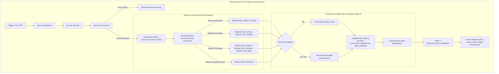

# Architecture Decision Record (ADR) 001: Enterprise Agentic Test Automation Architecture & AI Failure Triage

## Title: Enterprise CI/CD Test Pipeline with AI Failure Triage & DOM Security Sanitizer
- **Status**: Accepted
- **Date**: 2026-10-14
- **Author**: Principal Test Automation Architect & Security Engineer
- **Assigned Tier**: Tier 3 (Master / Enterprise Certification)

---

## 1. Context & Problem Statement

Modern enterprise end-to-end (E2E) automation suites face three critical operational bottlenecks:
1. **Triage Overhead**: Engineers spend up to 40% of sprint QA cycles investigating failed CI runs, manually differentiating genuine functional application defects (`[BUG]`) from flaky asynchronous race conditions (`[FLAKE]`), UI locator drift (`[LOCATOR_MISMATCH]`), or infrastructure/network timeouts (`[ENV_ERROR]`).
2. **Data Governance & PII Exposure Risks**: Feeding raw DOM snapshots, network payloads, or execution logs into external Large Language Models (LLMs) or Model Context Protocol (MCP) servers risks leaking sensitive customer credentials, Credit Card numbers, Authorization tokens, and Personal Identifiable Information (PII) in violation of GDPR, HIPAA, and PCI-DSS compliance standards.
3. **CI Pipeline Determinism & AI Cost**: Naive AI integrations in CI/CD introduce non-deterministic latencies, prohibitive token costs, and catastrophic pipeline blockage if third-party LLM endpoints experience rate limits or downtime.

A standardized, deterministic, and compliance-first architecture is required to automate failure analysis while guaranteeing zero data leakage and predictable execution costs.

---

## 2. Decision Drivers

- **Security & Compliance Mandate**: Zero transmission of unencrypted PII, credit card sequences, Bearer tokens, or session credentials to external AI APIs or third-party log aggregators.
- **Triage MTTR (Mean Time to Resolution)**: Reduce developer and SDET root-cause investigation time from >30 minutes to <15 seconds per failed run.
- **Categorization Determinism**: Exact-bucket tagging (`[BUG]`, `[FLAKE]`, `[LOCATOR_MISMATCH]`, `[ENV_ERROR]`) directly rendered in GitHub Actions Job Summaries with remediation steps.
- **Cost Efficiency & Token Optimization**: Minimize context payloads through selective extraction, structured JSON parsing, and lightweight LLM inference (`gpt-4o-mini` or equivalent high-throughput models).
- **Zero-Failure Fallback Guarantee**: CI workflows must never fail or halt due to LLM provider downtime or missing API keys.

---

## 3. Considered Options

### Option 1: Direct Raw Log Ingestion via LLM
- Send raw Playwright execution traces, console outputs, and HTML dumps directly to OpenAI / Anthropic APIs from CI.
- *Disadvantages*: Critical PCI/PII compliance violation; massive token bloat (100k+ tokens per trace dump); costly; pipeline breaks if API throttles.

### Option 2: Post-Mortem Manual Triage Dashboard
- Rely exclusively on Playwright HTML reports and local artifact inspection without automated intelligence.
- *Disadvantages*: High engineering overhead, slow turnaround on regression detection, no automated categorization.

### Option 3: Hybrid Architecture — Local Security Gateway with Autonomous AI Triage & Deterministic Heuristic Fallback (Chosen)
- Ingest structured Playwright JSON reports and trace metadata.
- Route all text, DOM snapshots, and network headers through an in-memory `SecuritySanitizer` gateway.
- Execute classification via low-cost LLM reasoning with an immediate, deterministic heuristic rule engine fallback.
- Stream clean Markdown summaries directly to `$GITHUB_STEP_SUMMARY` and upload sanitized diagnostics.

---

## 4. Decision Outcome & Architecture Topology

We have adopted **Option 3: Hybrid Agentic Test Architecture with Strict Security Gateway**.

### 4.1 System Topology Diagram

### 4.2 Security Governance & Data Scrubbing Boundary

The `SecuritySanitizer` module acts as a strict firewall between test artifacts and AI/external services:

1. **Payment Card Industry (PCI) Protection**:
   - Matches delimited card numbers (`4111-XXXX-XXXX-XXXX`, Amex 4-6-5 blocks).
   - Validates unformatted digit streams (13–19 characters) using the **Luhn Algorithm** to prevent false positives on timestamps while intercepting all valid PANs.
   - Replaced by: `[REDACTED_CREDIT_CARD]`.

2. **Personal Identifiable Information (PII)**:
   - Social Security Numbers: `\b\d{3}-\d{2}-\d{4}\b` -> `[REDACTED_SSN]`.
   - Formatted Phone Numbers (US & International) -> `[REDACTED_PHONE]`.
   - Email Addresses (RFC-compliant) -> `[REDACTED_EMAIL]`.

3. **Authentication & Session Tokens**:
   - Bearer tokens & JWTs (`Bearer eyJ...`) -> `Bearer [REDACTED_TOKEN]`.
   - HTTP Headers (`Authorization`, `x-api-key`, `Cookie`, `Set-Cookie`) -> `[REDACTED_AUTH]`.
   - Credentials in query strings & JSON payloads (`password`, `apiKey`, `secret`) -> `[REDACTED_SECRET]`.

4. **DOM & HTML Structure Invariance**:
   - DOM input fields (`<input type="password" value="...">`) are scrubbed at the attribute level while preserving HTML element tags, classes, and IDs for valid DOM inspection.
   - Stringified JSON is parsed and scrubbed without breaking JSON syntax validity.
   - Deep-cloning with `WeakSet` cycle detection prevents memory exhaustion or stack overflows on recursive payloads.

---

### 4.3 Operational Reliability & Cost Model

#### Service Level Objectives (SLOs)
| Metric | SLO Target | Measurement Method |
| :--- | :--- | :--- |
| **Suite Flakiness Rate** | `< 0.5%` | `flaky` test executions divided by total runs in `report.json` |
| **Triage Categorization Accuracy** | `≥ 95%` | Verified via unit test matrix across defect patterns |
| **Triage Processing Latency** | `< 2.5s` | End-to-end execution time of `ai-triage.ts` |
| **PII Data Leakage** | **`0.0%` (Zero Tolerance)** | Continuous audit via `tests/unit/sanitizer.spec.ts` |
| **Pipeline Reliability** | `100%` | Heuristic fallback ensures CI job step never crashes |

#### Token Cost Projection (Based on `gpt-4o-mini`)
- **Input Context per Failure**:
  - Sanitized Error Message: ~150 tokens
  - Sanitized Stack Trace (top 15 frames): ~350 tokens
  - Sanitized DOM Snapshot slice (1KB): ~300 tokens
  - Prompt Overhead: ~100 tokens
  - **Total Input Tokens**: ~900 tokens ($0.150 per 1M tokens = **$0.000135**)
- **Output Completion per Failure**:
  - Category Token + 2-sentence rationale: ~80 tokens ($0.600 per 1M tokens = **$0.000048**)
- **Cost per Triaged Failure**: **~$0.000183** (less than 2/100ths of a cent)

**Enterprise Monthly Cost Projection (5,000 CI Runs/Month @ 5% Failure Rate = 250 Failures)**:
$$\text{Monthly Cost} = 250 \times \$0.000183 = \mathbf{\$0.046 \text{ USD / month}}$$

Even at 10x volume (2,500 failures/month), total AI triage expenditure remains under **$0.50 USD / month**, while saving hundreds of engineering hours.

---

## 5. Consequences & Trade-offs

### Positive Impacts
- **Instant Developer Feedback**: Pull request authors receive classified failure analysis directly in their GitHub checks UI with exact remediation steps.
- **Enterprise Regulatory Compliance**: Strict sanitization satisfies SOC2, PCI-DSS, and GDPR requirements before sending telemetry outside the secure VPC.
- **Resilient Pipeline**: Zero dependency on external network availability for basic triage thanks to dual-mode heuristic fallback.
- **Zero Flakiness Culture**: Tagging `[FLAKE]` separates test debt from true application bugs, maintaining developer trust in CI gates.

### Trade-offs & Mitigations
- **Regex Maintenance**: As new PII patterns or proprietary tokens are introduced, regex rules must be maintained.
  *Mitigation*: Centralized `SecuritySanitizer` with automated unit testing suite (`tests/unit/sanitizer.spec.ts`) running on every commit.
- **DOM Snapshot Truncation**: Snapping only the first 1KB of DOM context might omit deeply nested components.
  *Mitigation*: Full Playwright trace artifacts (`.zip`) are preserved as GitHub Action artifacts for deep human inspection.
