# Test Architecture - How Test Cases Are Built

This document explains the layered architecture of this Playwright test suite and how every spec file connects to its dependencies.

---

## 1. The Big Picture - Layer Overview

The project follows a strict **Page Object Model (POM)** pattern with **Fixture-Driven Dependency Injection**. There are 5 distinct layers:

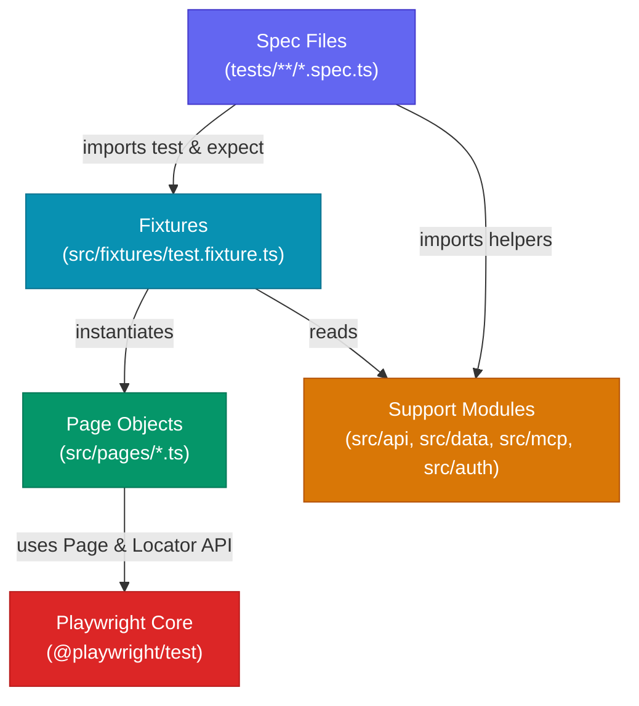

> **Rule**: Spec files **never** talk to Playwright directly. They only consume fixtures.

---

## 2. Fixture Dependency Injection - How Pages Reach the Test

Every fixture is registered in `test.fixture.ts` and injected into specs automatically. The chain always starts from Playwright`s `page` object.

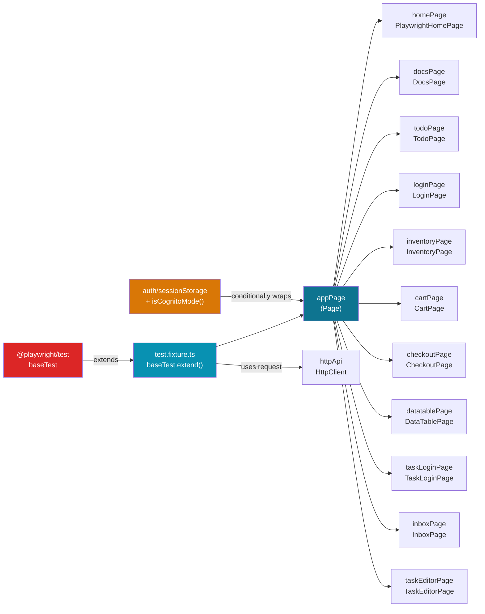

> The `appPage` fixture acts as the **single entry point** for every Page Object. It transparently handles both plain and Cognito-authenticated browser contexts.

---

## 3. Page Object Inheritance - The Class Hierarchy

All Page Objects **extend `BasePage`**, which provides shared navigation and utility methods.

```mermaid
classDiagram
    class BasePage {
        #page: Page
        +navigate(path) void
        +waitForPageLoad() void
        +assertUrlContains(text) void
        +takeScreenshot(name) Buffer
        +dismissBlockingDialogIfPresent() void
    }

    class PlaywrightHomePage {
        -searchButton: Locator
        -searchInput: Locator
        +open() void
        +openSearchModal() void
        +searchFor(query) void
        +assertSearchResultsVisible() void
        +selectSearchResult(name) void
    }

    class DocsPage {
        -pageTitle: Locator
        -languageSelector: Locator
        +openLocators() void
        +verifyHeading(text) void
        +switchLanguage(lang) void
        +assertCodeSnippetContains(text) void
        +assertCodeSnippetDoesNotContain(text) void
        +toggleTheme() void
        +getCurrentTheme() string
        +assertTheme(mode) void
    }

    class TodoPage {
        -newTodoInput: Locator
        -todoItems: Locator
        +open() void
        +addTodo(text) void
        +addTodos(items) void
        +markAsCompleted(text) void
        +filterBy(filter) void
        +clearCompleted() void
        +assertVisibleTodosCount(n) void
        +assertVisibleTodosText(items) void
        +assertTodoCompleted(text) void
        +assertItemsLeft(n) void
    }

    class LoginPage {
        -usernameInput: Locator
        -passwordInput: Locator
        +open() void
        +loginWithStandardUser() void
        +loginWithCredentials(u, p) void
    }

    class InventoryPage {
        -sortDropdown: Locator
        -cartBadge: Locator
        -itemNames: Locator
        -itemPrices: Locator
        +assertOnInventoryPage() void
        +sortBy(option) void
        +assertSortedByName(dir) void
        +assertSortedByPrice(dir) void
        +getItemNames() string[]
        +getItemPrices() number[]
        +addItemToCart(name) void
        +addMultipleItemsToCart(names) void
        +removeItemFromCart(name) void
        +assertCartBadgeCount(n) void
        +assertCartBadgeHidden() void
        +goToCart() void
        +setupNetworkLatencyRoute(pattern, ms) void
        +setupMockInventoryRoute(url, payload, status) void
    }

    class CartPage {
        -cartItems: Locator
        +assertOnCartPage() void
        +assertCartItemsCount(n) void
        +assertItemInCart(name) void
        +proceedToCheckout() void
        +removeItem(name) void
        +continueShopping() void
    }

    class CheckoutPage {
        -firstNameInput: Locator
        -lastNameInput: Locator
        -errorMessage: Locator
        +assertOnStepOne() void
        +fillShippingInformation(f, l, z) void
        +assertStepOneError(msg) void
        +assertOnOverviewPage() void
        +getSubtotal() number
        +getTax() number
        +getTotal() number
        +assertSubtotal(val) void
        +assertTax(val) void
        +assertTotal(val) void
        +assertCalculationsMatch(obj) void
        +finishCheckout() void
        +assertOrderComplete() void
        +backToHome() void
    }

    class DataTablePage {
        -searchInput: Locator
        -bodyRows: Locator
        -infoText: Locator
        -pageButtons: Locator
        +open() void
        +assertTableLoaded() void
        +sortByColumn(col, dir) Response
        +sortMultiColumn(cols) Response[]
        +goToPage(n) Response
        +goToFirstPage() Response
        +goToLastPage() Response
        +search(query) Response
        +clearSearch() Response
        +getSearchInputValue() string
        +assertRowCount(n) void
        +assertPaginationRange(f, t, total) void
        +assertColumnSorted(col, dir) void
        +assertActivePage(n) void
        +assertAllVisibleRowsMatch(col, text) void
        +assertEmptyState() void
        +getAllRowsData() TableRowData[]
        +getNumericColumnValues(col) number[]
        +parseSalaryToNumber(str) number
    }

    class TaskLoginPage {
        -usernameInput: Locator
        -passwordInput: Locator
        -loginButton: Locator
        -closeBannerButtons: Locator
        +open() void
        +dismissBannersIfPresent() void
        +login(user, pass) void
        +assertLoggedIn() void
    }

    class InboxPage {
        -taskTextarea: Locator
        -addTaskButton: Locator
        -quickActionsButton: Locator
        +openInbox() void
        +createTask(title) void
        +assertTaskVisible(title) void
        +selectTask(title) void
        +completeTask(title) void
        +assertTaskCompleted(title) void
        +dismissActiveModal() void
        +assertQuickActionsVisible() void
    }

    class TaskEditorPage {
        -backToProjectButton: Locator
        +assertEditorOpen(title) void
        +closeEditor(title) void
        +assertEditorClosed(title) void
    }

    BasePage <|-- PlaywrightHomePage
    BasePage <|-- DocsPage
    BasePage <|-- TodoPage
    BasePage <|-- LoginPage
    BasePage <|-- InventoryPage
    BasePage <|-- CartPage
    BasePage <|-- CheckoutPage
    BasePage <|-- DataTablePage
    BasePage <|-- TaskLoginPage
    BasePage <|-- InboxPage
    BasePage <|-- TaskEditorPage
```

---

## 4. Spec - Fixture - Page Connections

### 4.1 - Smoke: Playwright Documentation Explorer (Challenge 1.1)

**Archivo:** `tests/smoke/playwright-docs.spec.ts` - Tags: `@smoke @foundational`

Verifica el flujo completo de descubrimiento de documentacion: busqueda dinamica con modal, reactividad de snippets de codigo al cambiar lenguaje (Node.js a Python), y conmutacion de tema oscuro/claro mediante el atributo `data-theme` del elemento `<html>`.

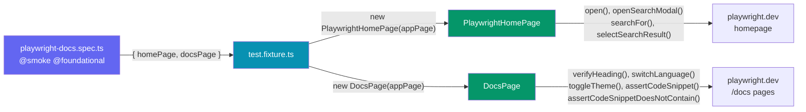

| Test | Que valida |
|---|---|
| Full workflow: search to theme toggle | Busqueda modal + navegacion + language switch + theme toggle encadenados |
| Search and navigate to docs page | Modal de busqueda + resultado correcto |
| Switch language snippet | Reactivity de Node.js a Python en snippets de codigo |
| Toggle theme | Atributo `data-theme` del root html cambia al presionar el boton de tema |

---

### 4.2 - Smoke: TodoMVC Core Workflow (Challenge 1.2)

**Archivo:** `tests/smoke/todo-crud.spec.ts` - Tags: `@smoke @foundational`

Automatiza el ciclo CRUD completo sobre la aplicacion TodoMVC: creacion de items, marcado como completado, filtrado por estados Active/Completed, y limpieza de completados con verificacion del conteo final.

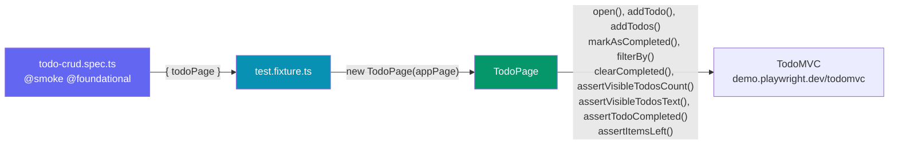

| Test | Que valida |
|---|---|
| Full lifecycle: add, complete, filter, clear | Ciclo completo CRUD con 3 items y verificacion de estado consolidado |
| Add distinct items and update counter | Creacion incremental y validacion del contador de items |
| Filter by Active and Completed states | Filtros separados con conteo exacto |
| Clear completed, retain active | `clearCompleted()` elimina solo los completados y preserva los activos |

---

### 4.3 - Smoke: Real Task App Workflows (Challenge 2.3)

**Archivo:** `tests/smoke/task-app.spec.ts` - Tags: `@smoke @advanced`

Prueba sobre una aplicacion de gestion de tareas real con autenticacion. Cubre creacion de tareas desde el Inbox, apertura del editor de detalle, verificacion de metadata, y transicion de estado al completar una tarea.

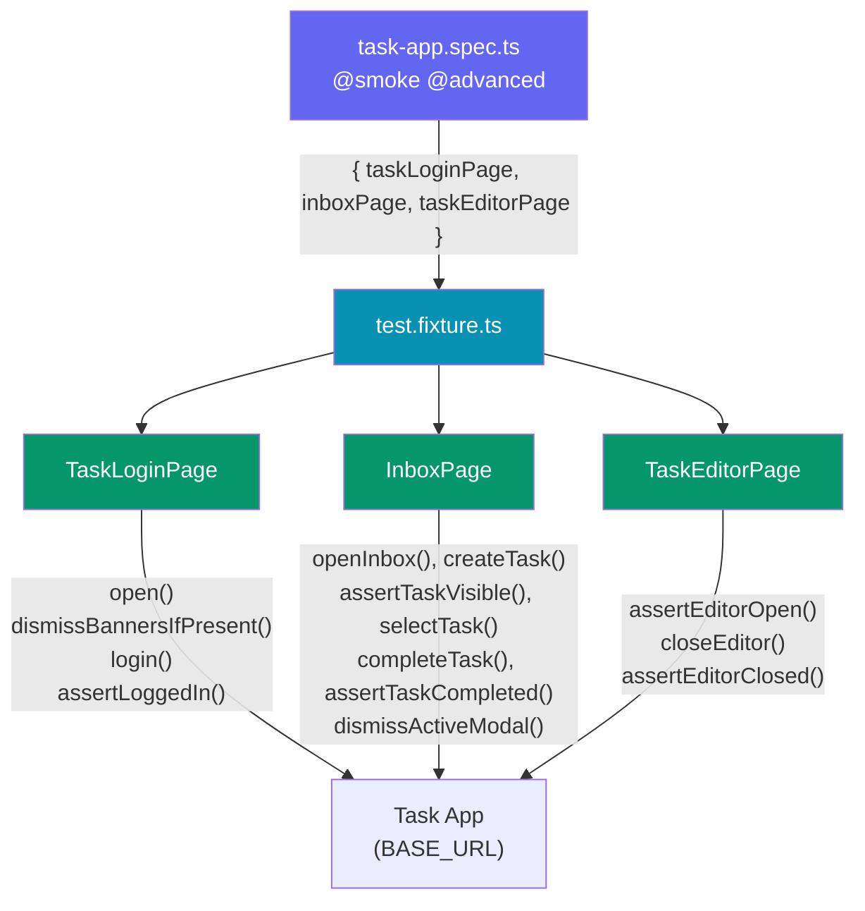

| Test | Que valida |
|---|---|
| Create a new task in the inbox | Creacion de tarea via textarea inline, visibilidad inmediata |
| Open task detail editor and verify metadata | Apertura del editor modal con heading correcto; cierre y desaparicion |
| Mark task as completed and verify status | Toggle de completion y transicion de estado en la vista activa |

**Clases nuevas introducidas:**

- **`TaskLoginPage`** - Gestiona la pantalla de login de la app de tareas. Soporta credenciales por env vars (`E2E_USER` / `E2E_PASSWORD`) con fallback a `demo/demo`. Descarta banners de aviso/cookies antes de interactuar con el formulario.
- **`InboxPage`** - Encapsula la vista principal del inbox: localizacion del textarea de creacion con soporte i18n via `.or()`, adicion de tareas, toggle de completion con imagen/checkbox visual, seleccion de tarea por link/texto, y dismissal de modales via `Escape`.
- **`TaskEditorPage`** - Encapsula el panel/modal de detalle de tarea: asercion del heading con el titulo exacto, cierre por boton de regreso o `Escape`, y verificacion de que el editor no esta visible.

---

### 4.4 - Regression: E-Commerce Checkout Flow (Challenge 2.1)

**Archivo:** `tests/regression/checkout-flow.spec.ts` - Tags: `@regression @advanced`

Suite de regresion completa para Swag Labs (SauceDemo). Integra el motor de pricing MCP personalizado para validar dinamicamente subtotales, impuestos y totales. Cubre: flujo E2E de compra, sorting de catalogo en 4 dimensiones, latencia de red con `page.route()`, simulacion de surge pricing, interceptacion de API de inventario para out-of-stock, validacion de errores de formulario, y sincronizacion del badge del carrito.

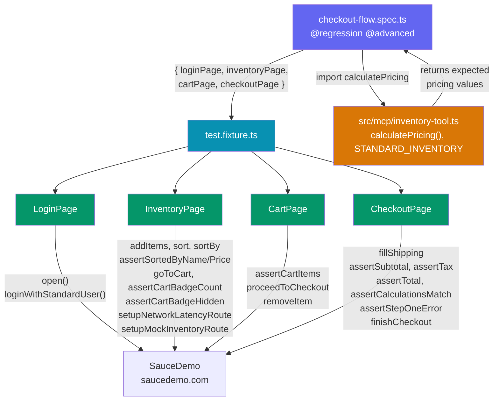

| Test | Que valida |
|---|---|
| E2E checkout with MCP pricing | Flujo completo: login, agregar items, checkout, verificar subtotal/tax/total contra MCP tool |
| Sort inventory across 4 dimensions | `az`, `za`, `lohi`, `hilo` con aserciones de orden sobre nombres y precios |
| Network latency with web-first auto-waiting | Route interceptor con 500ms delay; aserciones web-first sin `waitForTimeout` |
| Surge pricing with MCP override | `calculatePricing` con `priceOverrides` y `isSurgePricingApplied` flag |
| Out-of-stock API mock | Route mock que excluye `Sauce Labs Backpack`; MCP valida `outOfStockItemsExcluded` |
| Shipping form validation errors | Errores incrementales: sin nombre, sin apellido, sin codigo postal |
| Cart badge sync (add/remove) | Badge sincronizado al agregar/remover desde inventario y desde carrito |

---

### 4.5 - Regression: DataTable Server-Side Grid (Challenge 2.2)

**Archivo:** `tests/regression/datatable-sorting.spec.ts` - Tags: `@regression @advanced`

Suite de regresion para el grid server-side de DataTables. Valida: sorting compuesto multi-columna con Shift-click, paginacion en limites (pagina 1, 5, ultima y regreso a 1), indicadores de entrada en cada estado, busqueda global con debounce con respuesta XHR interceptada, y estado vacio ante query sin coincidencias.

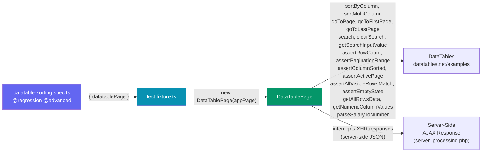

| Test | Que valida |
|---|---|
| Multi-column compound sort (Office asc, Salary desc) | Shift-click en columna secundaria; verificacion del orden dentro de Edinburgh |
| Single column sort asc/desc with XHR validation | `recordsTotal=57`; orden monotónico de salarios; primer valor = $1,200,000 desc |
| Pagination bounds: Page 1 to 5 to Last to 1 | Indicadores de rango en cada bound; ultima pagina = 7 filas (57 mod 10) |
| Debounced global search London | `recordsFiltered=12`; todas las filas visibles tienen Office = "London" |
| Non-matching search and empty state | `recordsFiltered=0`; mensaje "No matching records found"; restauracion al limpiar |

**Tipos TypeScript exportados por `DataTablePage`:**

| Tipo | Descripcion |
|---|---|
| `TableRowData` | Interface para los datos de una fila: `firstName`, `lastName`, `position`, `office`, `startDate`, `salary` |
| `ColumnHeaderName` | Union type de los 6 nombres de columna validos |
| `SortDirection` | `'asc' or 'desc'` |
| `ColumnSortOrder` | Config de sort `{ column, direction }` para `sortMultiColumn()` |
| `ServerProcessingResponse` | Schema del JSON server-side: `draw`, `recordsTotal`, `recordsFiltered`, `data` |
| `PaginationState` | Estado parseado del info text: `start`, `end`, `total`, `filteredTotal`, `rawText` |

---

### 4.6 - API: Health Check

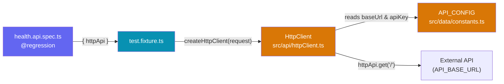

---

## 5. The Full Request Flow - Step by Step

When you run `npx playwright test`, here is the exact sequence of events:

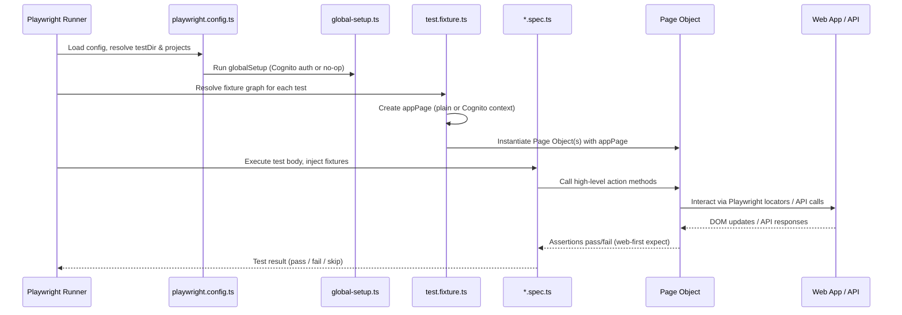

---

## 6. Support Modules - What Each One Does

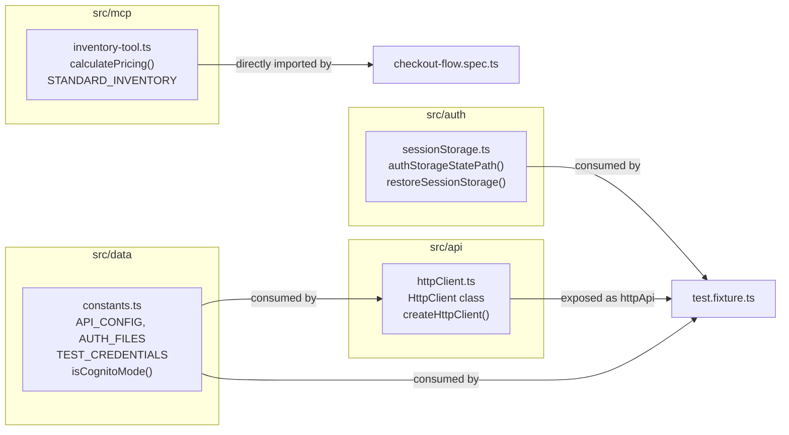

| Module | Purpose |
|---|---|
| `src/data/constants.ts` | Env-backed config (API URL, credentials, Cognito toggle) |
| `src/auth/sessionStorage.ts` | Saves/restores Cognito session for authenticated tests |
| `src/api/httpClient.ts` | Thin Playwright `APIRequestContext` wrapper for REST calls |
| `src/mcp/inventory-tool.ts` | MCP tool: pricing engine and mock catalog. Supports `priceOverrides`, `outOfStockProducts`, `excludeOutOfStock`; calculates subtotal, tax (8%) and formatted total |

---

## 7. Test Suite Summary

| Suite | Archivo | Tags | POM(s) | App target |
|---|---|---|---|---|
| **Challenge 1.1** - Docs Explorer | `smoke/playwright-docs.spec.ts` | `@smoke @foundational` | `PlaywrightHomePage`, `DocsPage` | playwright.dev |
| **Challenge 1.2** - TodoMVC CRUD | `smoke/todo-crud.spec.ts` | `@smoke @foundational` | `TodoPage` | demo.playwright.dev/todomvc |
| **Challenge 2.3** - Task App | `smoke/task-app.spec.ts` | `@smoke @advanced` | `TaskLoginPage`, `InboxPage`, `TaskEditorPage` | Task app (BASE_URL) |
| **Challenge 2.1** - E-Commerce | `regression/checkout-flow.spec.ts` | `@regression @advanced` | `LoginPage`, `InventoryPage`, `CartPage`, `CheckoutPage` | saucedemo.com |
| **Challenge 2.2** - Data Grid | `regression/datatable-sorting.spec.ts` | `@regression @advanced` | `DataTablePage` | datatables.net |
| **API Health** | `api/health.api.spec.ts` | `@regression` | `HttpClient` via fixture | API_BASE_URL |

---

## 8. Key Architecture Rules at a Glance

| Rule | Enforcement |
|---|---|
| No `new Page()` in specs | All pages injected via fixtures |
| No `page.locator()` in specs | Locators live only inside Page Objects |
| Import `test`/`expect` from `@fixtures` | Never from `@playwright/test` directly |
| No `waitForTimeout()` anywhere | Auto-waiting + web-first assertions only |
| Every test tagged `@smoke` or `@regression` | Enables project-level filtering in config |
| Network sync via `waitForResponse()` | `DataTablePage` uses XHR intercept to eliminate arbitrary timeouts |
| i18n-resilient locators | `TaskLoginPage` and `InboxPage` use `.or()` with bilingual regex (DE/EN) |
